<a href="https://shreeviraj.studio"><picture><source media="(prefers-color-scheme: dark) and (max-width: 600px)" srcset="assets/hero-m-green.svg"><source media="(max-width: 600px)" srcset="assets/hero-m-blue.svg"><source media="(prefers-color-scheme: dark)" srcset="assets/hero-green.svg"></picture></a>

<a href="mailto:shreeviraj5387@gmail.com"><picture><source media="(prefers-color-scheme: dark)" srcset="assets/pill-hire-green.svg"></picture></a> <a href="https://shreeviraj.studio"><picture><source media="(prefers-color-scheme: dark)" srcset="assets/pill-site-green.svg"></picture></a> <a href="https://x.com/shreeviraj_dev"><picture><source media="(prefers-color-scheme: dark)" srcset="assets/pill-x-green.svg"></picture></a> <a href="https://linkedin.com/in/shreeviraj"><picture><source media="(prefers-color-scheme: dark)" srcset="assets/pill-linkedin-green.svg"></picture></a> <a href="https://instagram.com/1cr.sri"><picture><source media="(prefers-color-scheme: dark)" srcset="assets/pill-instagram-green.svg"></picture></a>

 

<picture><source media="(prefers-color-scheme: dark) and (max-width: 600px)" srcset="assets/sec-hey-m-green.svg"><source media="(max-width: 600px)" srcset="assets/sec-hey-m-blue.svg"><source media="(prefers-color-scheme: dark)" srcset="assets/sec-hey-green.svg"></picture>

i'm **sree**. i build agents, memory systems and audit pipelines. mostly for hackathons, sometimes for clients, occasionally because something annoyed me. i also art direct, which is why this page looks the way it does.

EY techathon semi-finalist · top 10 at india innovates · three hackathon wins · judged cybersecurity at fusion 2k26 · 451 contributions last year, a third of them private

**currently** building antAi for smart india hackathon 2026, which catches voice clone scams before the money moves. open to freelance: agents, pipelines, automation.

python and typescript mostly. go and kotlin when the problem asks for it.

> keep the ai part invisible so the work gets judged as work.

 

<picture><source media="(prefers-color-scheme: dark) and (max-width: 600px)" srcset="assets/sec-worth-opening-m-green.svg"><source media="(max-width: 600px)" srcset="assets/sec-worth-opening-m-blue.svg"><source media="(prefers-color-scheme: dark)" srcset="assets/sec-worth-opening-green.svg"></picture>

<a href="https://github.com/reesick/COVENANT"><picture><source media="(prefers-color-scheme: dark) and (max-width: 600px)" srcset="assets/card-covenant-m-green.svg"><source media="(max-width: 600px)" srcset="assets/card-covenant-m-blue.svg"><source media="(prefers-color-scheme: dark)" srcset="assets/card-covenant-green.svg"></picture></a>

the research and golden test set behind it: [ey-research](https://github.com/reesick/ey-research)

<a href="https://github.com/reesick/memos"><picture><source media="(prefers-color-scheme: dark) and (max-width: 600px)" srcset="assets/card-memoryos-m-green.svg"><source media="(max-width: 600px)" srcset="assets/card-memoryos-m-blue.svg"><source media="(prefers-color-scheme: dark)" srcset="assets/card-memoryos-green.svg"></picture></a>

and a local first dashboard for it: [memos-v2](https://github.com/reesick/memos-v2)

<picture><source media="(prefers-color-scheme: dark) and (max-width: 600px)" srcset="assets/card-jqp-m-green.svg"><source media="(max-width: 600px)" srcset="assets/card-jqp-m-blue.svg"><source media="(prefers-color-scheme: dark)" srcset="assets/card-jqp-green.svg"></picture>

 

<picture><source media="(prefers-color-scheme: dark) and (max-width: 600px)" srcset="assets/sec-everything-else-m-green.svg"><source media="(max-width: 600px)" srcset="assets/sec-everything-else-m-blue.svg"><source media="(prefers-color-scheme: dark)" srcset="assets/sec-everything-else-green.svg"></picture>

### agents & retrieval
*things that decide, route, and keep running when i log off.*

| what | with what | the twist |
| --- | --- | --- |
| **[ABTalks agent](https://github.com/reesick/abtalkshackathon)** finds ai/ml topics, judges them against a persona, writes and posts | python · fastapi · flora | *ran 48 hours unattended. nobody touched it* |
| **[Excel Bot](https://github.com/reesick/Excel-bot)** telegram bot. send any messy spreadsheet, get an excel dashboard and a deck back | python · claude files api · code execution | *claude is the analyst. nobody tells it which columns matter* |
| **edi-5** `private` multi domain rag assistant. started on cricket, now does finance and general knowledge too | fastapi · groq · chroma · react | *it routes before it retrieves. live, historical and analytical questions each get their own path* |
| **requirements agent** `private` turns gmail threads and meet transcripts into a requirements doc | langgraph · gemini 2.5 flash · supabase pgvector | *the meeting ends, the spec is already written* |

### finance & compliance
*where a rounding error is a wrong answer.*

| what | with what | the twist |
| --- | --- | --- |
| **[SAR-mvp](https://github.com/reesick/SAR-mvp)** anti money laundering: writes the suspicious activity report for an analyst | langgraph · fastapi · pgvector · ollama | *seven agents and a local mistral. nothing leaves the machine* |
| **[ESG greenwashing agent](https://github.com/Pragati-1-7/Automated_ESG_Greenwashing_agent)** `collab` with pragati. reads a sustainability report and checks every claim against filings, regulators and news | python · agents · layout aware pdf parsing | *every claim ends as align, contradict or insufficient, with an audit trail and a 0 to 100 risk score* |
| **ml-challenge** `private` amazon ml challenge 2026. business entity resolution across three sources, three countries | python · blocking · pruner + matcher | *0.972 on local validation, 0.885 on the leaderboard. hunting the gap* |

### civic, health & security
*maps, faces and threat graphs.*

| what | with what | the twist |
| --- | --- | --- |
| **[drone swarm](https://github.com/tusharsingh-spring/drone_swarm)** `collab` with tushar. a flood and fire response simulator for pune and pcmc | python · websockets · 3d map | *up to 100 modelled drones working alongside real pcmc ground units* |
| **[PS-CRM](https://github.com/reesick/pscrm)** civic grievance crm for delhi mcd, built as team blackhaze | fastapi · next.js · langgraph · gemini · postgis | *every complaint is a point on a map, and an agent decides where it goes* |
| **[CLINDerm](https://github.com/reesick/clinderm)** three face photos in, an annotated skin health report out | yunet · mediapipe · segformer · yolov8 | *four vision models, all running locally on a laptop 4050* |
| **[threat forecasting](https://github.com/reesick/cybersec-ind)** forecasts cyber threats and the tech that counters them | python · bayesian gnn · nvd · gdelt | *a 2025 paper rebuilt end to end, with honest fallbacks when the apis say no* |

### learning & small fixes
*software that teaches back, and one that fixes college.*

| what | with what | the twist |
| --- | --- | --- |
| **[Avinya](https://github.com/reesick/avinya)** personalised video learning with a hybrid recommender | react · fastapi · supabase · lightfm | *three recommenders blended: content, collaborative and knowledge based* |
| **[algo visualiser](https://github.com/reesick/edai-3-f1)** algorithm visualiser with an ai tutor that watches how you learn | react · go · python · gemini | *pause too long and it slows down. hit replay and it gets technical* |
| **Better VOLP** `private` a cleaner client for my college's classroom platform | next.js · prisma · cron | *emails you 48 hours before an assignment is due. the original never did* |

`private` means named, not linked. ask and i'll walk you through it. `collab` means a team repo i build in.

 

<a href="mailto:shreeviraj5387@gmail.com"><picture><source media="(prefers-color-scheme: dark) and (max-width: 600px)" srcset="assets/footer-m-green.svg"><source media="(max-width: 600px)" srcset="assets/footer-m-blue.svg"><source media="(prefers-color-scheme: dark)" srcset="assets/footer-green.svg"></picture></a>
