<a href="https://shreeviraj.studio"><picture><source media="(prefers-color-scheme: dark) and (max-width: 600px)" srcset="assets/hero-m-green.svg"><source media="(max-width: 600px)" srcset="assets/hero-m-blue.svg"><source media="(prefers-color-scheme: dark)" srcset="assets/hero-green.svg"></picture></a>

<a href="mailto:shreeviraj5387@gmail.com"><picture><source media="(prefers-color-scheme: dark)" srcset="assets/pill-hire-green.svg"></picture></a> <a href="https://shreeviraj.studio"><picture><source media="(prefers-color-scheme: dark)" srcset="assets/pill-site-green.svg"></picture></a> <a href="https://x.com/shreeviraj_dev"><picture><source media="(prefers-color-scheme: dark)" srcset="assets/pill-x-green.svg"></picture></a> <a href="https://linkedin.com/in/shreeviraj"><picture><source media="(prefers-color-scheme: dark)" srcset="assets/pill-linkedin-green.svg"></picture></a> <a href="https://instagram.com/1cr.sri"><picture><source media="(prefers-color-scheme: dark)" srcset="assets/pill-instagram-green.svg"></picture></a>

 

<picture><source media="(prefers-color-scheme: dark) and (max-width: 600px)" srcset="assets/sec-hey-m-green.svg"><source media="(max-width: 600px)" srcset="assets/sec-hey-m-blue.svg"><source media="(prefers-color-scheme: dark)" srcset="assets/sec-hey-green.svg"></picture>

i'm **sree**. i build agents, memory systems and audit pipelines. mostly for hackathons, sometimes for clients, occasionally because something annoyed me. i also art direct, which is why this page looks the way it does.

EY techathon semi-finalist · top 10 at india innovates · three hackathon wins · judged cybersecurity at fusion 2k26 · 451 contributions last year, a third of them private

**currently** building antAi for smart india hackathon 2026, which catches voice clone scams before the money moves. open to freelance: agents, pipelines, automation.

python and typescript mostly. go and kotlin when the problem asks for it.

> keep the ai part invisible so the work gets judged as work.

 

<picture><source media="(prefers-color-scheme: dark) and (max-width: 600px)" srcset="assets/sec-worth-opening-m-green.svg"><source media="(max-width: 600px)" srcset="assets/sec-worth-opening-m-blue.svg"><source media="(prefers-color-scheme: dark)" srcset="assets/sec-worth-opening-green.svg"></picture>

<picture><source media="(prefers-color-scheme: dark) and (max-width: 600px)" srcset="assets/card-jqp-m-green.svg"><source media="(max-width: 600px)" srcset="assets/card-jqp-m-blue.svg"><source media="(prefers-color-scheme: dark)" srcset="assets/card-jqp-green.svg"></picture>

<picture><source media="(prefers-color-scheme: dark) and (max-width: 600px)" srcset="assets/card-ml-challenge-m-green.svg"><source media="(max-width: 600px)" srcset="assets/card-ml-challenge-m-blue.svg"><source media="(prefers-color-scheme: dark)" srcset="assets/card-ml-challenge-green.svg"></picture>

<a href="https://github.com/reesick/pscrm"><picture><source media="(prefers-color-scheme: dark) and (max-width: 600px)" srcset="assets/card-pscrm-m-green.svg"><source media="(max-width: 600px)" srcset="assets/card-pscrm-m-blue.svg"><source media="(prefers-color-scheme: dark)" srcset="assets/card-pscrm-green.svg"></picture></a>

 

<picture><source media="(prefers-color-scheme: dark) and (max-width: 600px)" srcset="assets/sec-everything-else-m-green.svg"><source media="(max-width: 600px)" srcset="assets/sec-everything-else-m-blue.svg"><source media="(prefers-color-scheme: dark)" srcset="assets/sec-everything-else-green.svg"></picture>

### agents & automation
*things that decide, and keep running when i log off.*

| what | with what | the twist |
| --- | --- | --- |
| **requirements agent** `private` turns gmail threads and meet transcripts into a requirements doc | langgraph · gemini · supabase | *the meeting ends, the spec is already written* |
| **[ABTalks agent](https://github.com/reesick/abtalkshackathon)** finds ai/ml topics, judges them against a persona, writes and posts | python · fastapi · flora | *ran 48 hours unattended. nobody touched it* |
| **ClipFarm** `private` repost pipeline for clipping programs. reframes, brands, de-dupes and checks a clip before it goes up | python · ffmpeg · flask | *fully offline, no accounts, no api keys. it tells you if the post will get approved* |

### vision & forecasting
*faces, threats, and people’s futures. no pressure.*

| what | with what | the twist |
| --- | --- | --- |
| **[face detection, deployed](https://github.com/reesick/nhai)** scrfd face detection packaged to run anywhere, with a quantisation study | pytorch · onnx runtime · scrfd | *quantised it to int8, measured it, shipped fp32 anyway. 30 fps on a plain cpu* |
| **[threat forecasting](https://github.com/reesick/cybersec-ind)** forecasts cyber threats and the tech that counters them | python · bayesian gnn · nvd · gdelt | *a 2025 paper rebuilt end to end, with honest fallbacks when the apis say no* |
| **[career recommender](https://github.com/reesick/sihreccadv)** smart india hackathon. a personality test goes in, careers come out | fastapi · faiss · sentence transformers · supabase | *big five and riasec scores turned into a semantic search over careers* |

### memory & learning
*software that remembers, and software that teaches back.*

| what | with what | the twist |
| --- | --- | --- |
| **[memos v2](https://github.com/reesick/memos-v2)** local first memory workspace for llm apps, with a dashboard to browse what it remembers | typescript · next.js · sqlite | *runs on synthetic embeddings, so you can try it without a single api key* |
| **[algo visualiser](https://github.com/reesick/edai-3-f1)** algorithm visualiser with an ai tutor that watches how you learn | react · go · python · gemini | *pause too long and it slows down. hit replay and it gets technical* |

`private` means named, not linked. ask and i'll walk you through it.

 

<a href="mailto:shreeviraj5387@gmail.com"><picture><source media="(prefers-color-scheme: dark) and (max-width: 600px)" srcset="assets/footer-m-green.svg"><source media="(max-width: 600px)" srcset="assets/footer-m-blue.svg"><source media="(prefers-color-scheme: dark)" srcset="assets/footer-green.svg"></picture></a>
