<a href="https://shreeviraj.studio"><picture><source media="(prefers-color-scheme: dark) and (max-width: 600px)" srcset="assets/hero-m-green.svg"><source media="(max-width: 600px)" srcset="assets/hero-m-blue.svg"><source media="(prefers-color-scheme: dark)" srcset="assets/hero-green.svg"></picture></a>

<a href="mailto:shreeviraj5387@gmail.com"><picture><source media="(prefers-color-scheme: dark)" srcset="assets/pill-hire-green.svg"></picture></a> <a href="https://shreeviraj.studio"><picture><source media="(prefers-color-scheme: dark)" srcset="assets/pill-site-green.svg"></picture></a> <a href="https://jacquard.shreeviraj.studio"><picture><source media="(prefers-color-scheme: dark)" srcset="assets/pill-studio-green.svg"></picture></a> <a href="https://x.com/shreeviraj_dev"><picture><source media="(prefers-color-scheme: dark)" srcset="assets/pill-x-green.svg"></picture></a> <a href="https://linkedin.com/in/shreeviraj"><picture><source media="(prefers-color-scheme: dark)" srcset="assets/pill-linkedin-green.svg"></picture></a> <a href="https://instagram.com/1cr.sri"><picture><source media="(prefers-color-scheme: dark)" srcset="assets/pill-instagram-green.svg"></picture></a>

<br>

<picture><source media="(prefers-color-scheme: dark) and (max-width: 600px)" srcset="assets/sec-hey-m-green.svg"><source media="(max-width: 600px)" srcset="assets/sec-hey-m-blue.svg"><source media="(prefers-color-scheme: dark)" srcset="assets/sec-hey-green.svg"></picture>

i'm **sree**. half of me runs [jacquard studio](https://jacquard.shreeviraj.studio), an ai led visual studio for fashion and ecommerce brands. the other half writes agents, memory systems and audit pipelines. usually for a hackathon, sometimes for a client, occasionally just to see if it works.

b.tech cse (ai/ml) at [vit pune](https://www.vit.edu). EY techathon semi-finalist. top 10 at india innovates.

> keep the ai part invisible so the work gets judged as work.

> ship something a hundred thousand people use.

<br>

<picture><source media="(prefers-color-scheme: dark) and (max-width: 600px)" srcset="assets/sec-things-ive-built-m-green.svg"><source media="(max-width: 600px)" srcset="assets/sec-things-ive-built-m-blue.svg"><source media="(prefers-color-scheme: dark)" srcset="assets/sec-things-ive-built-green.svg"></picture>

### agents & memory
*things that remember, decide, and keep running when i log off.*

|    | what | with what | the twist |
| --- | --- | --- | --- |
| `01` | **[MemoryOS](https://github.com/reesick/memos)**<br>open memory middleware for any llm app | python · knowledge graph · hybrid retrieval | *not plain rag. it extracts facts, settles conflicts and recalls across three stores at once* |
| `02` | **[memos v2](https://github.com/reesick/memos-v2)**<br>local first memory workspace with a dashboard to browse it | typescript · next.js · sqlite | *runs on synthetic embeddings, so you can try it without a single api key* |
| `03` | **[ABTalks agent](https://github.com/reesick/abtalkshackathon)**<br>finds topics, judges them against a persona, writes and posts | python · fastapi · flora | *left alone for 48 hours. nobody touched it* |
| `04` | **[Excel Bot](https://github.com/reesick/Excel-bot)**<br>telegram bot. send any messy file, get an excel dashboard and a deck back | python · claude code execution · telegram | *claude is the analyst. no picking columns, no questions asked* |

### audit & finance
*where a rounding error is a bug, not a detail.*

|    | what | with what | the twist |
| --- | --- | --- | --- |
| `01` | **[COVENANT](https://github.com/reesick/COVENANT)**<br>audit grade covenant compliance testing for private credit | python · sympy · faiss · pdfplumber | *zero floats. exact rational maths, and every run is hash chained and timestamped* |
| `02` | **[ey research](https://github.com/reesick/ey-research)**<br>the research and golden test set behind it, built for the EY techathon | sec edgar · xbrl · python | *two fake borrowers with planted errors. one of them is quietly in breach* |

### civic, health, security
*maps, faces and threat graphs.*

|    | what | with what | the twist |
| --- | --- | --- | --- |
| `01` | **[PS-CRM](https://github.com/reesick/pscrm)**<br>smart public service crm for delhi mcd grievances | fastapi · langgraph · gemini · postgis · maplibre | *every complaint is a point on a map, and an agent decides where it goes* |
| `02` | **[CLINDerm](https://github.com/reesick/clinderm)**<br>ai facial skin health screening | yunet · mediapipe · segformer · yolov8 | *four vision models chained into one screening pass* |
| `03` | **[threat forecasting](https://github.com/reesick/cybersec-ind)**<br>forecasts cyber threats and the tech that counters them | python · bayesian gnn · nvd · gdelt | *a 2025 paper rebuilt end to end, with synthetic fallbacks for when the apis say no* |

### learning
*software that teaches back.*

|    | what | with what | the twist |
| --- | --- | --- | --- |
| `01` | **[Avinya](https://github.com/reesick/avinya)**<br>personalised video learning with a hybrid recommender | react · fastapi · supabase · lightfm | *three recommenders blended: content, collaborative and knowledge based* |
| `02` | **[algo visualiser](https://github.com/reesick/edai-3-f1)**<br>algorithm visualiser with an ai tutor that watches how you learn | react · go · python · gemini | *pause too long and it slows down. hit replay and it gets technical* |

### studio
*not on github, but it's where the code goes to work.*

|    | what | with what | the twist |
| --- | --- | --- | --- |
| `01` | **[JaCquard Studio](https://jacquard.shreeviraj.studio)**<br>ai led visual production for fashion, lifestyle and ecommerce brands | image + video models · custom pipelines | *the ai part stays invisible, so the work gets judged as work* |
| `02` | **HyperFuel**<br>streetwear label with an ai campaign pipeline behind every drop | nano banana pro · higgsfield | *a full lookbook, no shoot day* |

<br>

<picture><source media="(prefers-color-scheme: dark) and (max-width: 600px)" srcset="assets/sec-right-now-m-green.svg"><source media="(max-width: 600px)" srcset="assets/sec-right-now-m-blue.svg"><source media="(prefers-color-scheme: dark)" srcset="assets/sec-right-now-green.svg"></picture>

- **antAi** for smart india hackathon 2026. fuses voice, video, text and intent into one 0 to 100 risk score to catch voice clone scams. *then it logs, verifies, or freezes.*
- **jacquard studio**, taking on fashion and ecommerce brands. *dms are open.*
- **hyperfuel**, the next drop and its campaign. *still no shoot day.*
- judged the cybersecurity track at **fusion 2k26**. *turns out judging is harder than pitching.*

<br>

<picture><source media="(prefers-color-scheme: dark) and (max-width: 600px)" srcset="assets/sec-stack-m-green.svg"><source media="(max-width: 600px)" srcset="assets/sec-stack-m-blue.svg"><source media="(prefers-color-scheme: dark)" srcset="assets/sec-stack-green.svg"></picture>

**languages**<br>
<picture><source media="(prefers-color-scheme: dark)" srcset="https://skillicons.dev/icons?i=python,ts,js,cpp,kotlin,go,html,css&perline=12&theme=dark"></picture>

**web & backend**<br>
<picture><source media="(prefers-color-scheme: dark)" srcset="https://skillicons.dev/icons?i=react,nextjs,nodejs,fastapi,tailwind,supabase,postgres,sqlite&perline=12&theme=dark"></picture>

**ai & ml**<br>
<picture><source media="(prefers-color-scheme: dark)" srcset="https://skillicons.dev/icons?i=pytorch,tensorflow,opencv,sklearn&perline=12&theme=dark"></picture>

**tools**<br>
<picture><source media="(prefers-color-scheme: dark)" srcset="https://skillicons.dev/icons?i=git,github,docker,vercel,vscode,postman&perline=12&theme=dark"></picture>

<br>

**i also**

```
art direct campaigns
prompt until it looks shot
judge hackathons · ship at 2am
chronically online
```

*the commit graph has a sleep schedule. i don't.*

<br>

<picture><source media="(prefers-color-scheme: dark) and (max-width: 600px)" srcset="assets/sec-numbers-m-green.svg"><source media="(max-width: 600px)" srcset="assets/sec-numbers-m-blue.svg"><source media="(prefers-color-scheme: dark)" srcset="assets/sec-numbers-green.svg"></picture>

<picture><source media="(prefers-color-scheme: dark) and (max-width: 600px)" srcset="assets/numbers-m-green.svg"><source media="(max-width: 600px)" srcset="assets/numbers-m-blue.svg"><source media="(prefers-color-scheme: dark)" srcset="assets/numbers-green.svg"></picture>

<br>

<a href="mailto:shreeviraj5387@gmail.com"><picture><source media="(prefers-color-scheme: dark) and (max-width: 600px)" srcset="assets/footer-m-green.svg"><source media="(max-width: 600px)" srcset="assets/footer-m-blue.svg"><source media="(prefers-color-scheme: dark)" srcset="assets/footer-green.svg"></picture></a>
